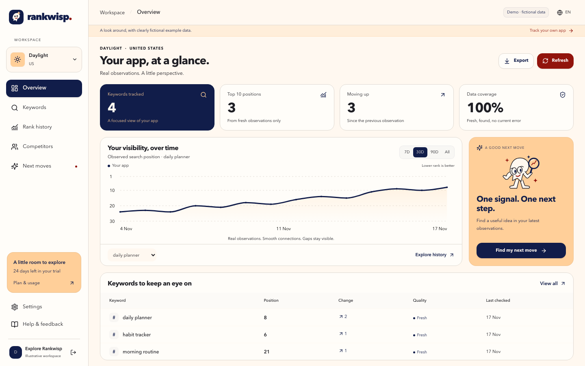
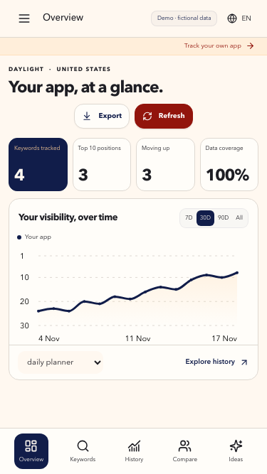
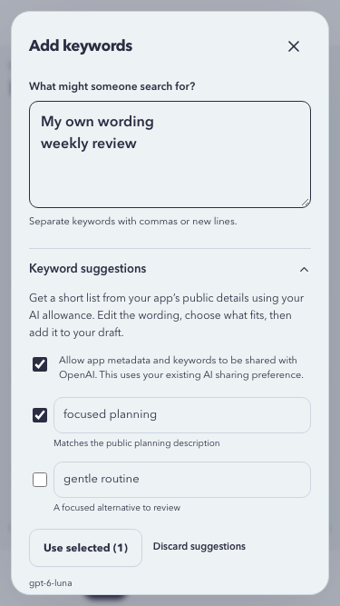

<p align="center"></p>
<h1 align="center">Rankwisp</h1>
<p align="center"><strong>Open-Source-Keyword-Recherche für den App Store.</strong><br>Suchpositionen verfolgen. Apps vergleichen. Neue Suchbegriffe entdecken.</p>
<p align="center">
<a href="https://github.com/Yann1s2/Rankwisp/actions/workflows/ci.yml"></a>
<a href="LICENSE"></a>
<a href="https://github.com/Yann1s2/Rankwisp/releases/tag/v0.2.0-preview.1"></a>
</p>
<p align="center"><a href="https://rank.zhstudio.ch/app/?demo=1"></a> <a href="https://github.com/Yann1s2/Rankwisp/releases/tag/v0.2.0-preview.1"></a></p>
<p align="center"><a href="#lokal-starten">Lokal starten</a> · <a href="docs/GETTING-STARTED.md">Dokumentation</a> · <a href="CONTRIBUTING.md">Mitmachen</a> · <a href="README.md">English</a></p>

Rankwisp unterstützt unabhängige iOS-Entwickler bei der **App Store Optimization (ASO)**: Keyword-Positionen in 20 Store-Ländern beobachten, ausgewählte Mitbewerber vergleichen und die eigene Historie exportieren. Web-App, native Clients und Backend sind unter MIT offen verfügbar.

> **Öffentliche Vorabversion:** Die Demo enthält fiktive Daten und braucht kein Konto. Google-Anmeldung, KI-Generierung und Käufe sind im gehosteten Dienst noch nicht aktiviert. Für echte Recherche kannst du die App lokal starten; Apples Suche benötigt keinen API-Key.

[](https://rank.zhstudio.ch/app/?demo=1)

## Was du damit machen kannst

- **Keywords verfolgen:** Beobachtete Positionen, fehlende Treffer und Fehler bleiben nachvollziehbar. Lücken werden nicht erfunden.
- **Apps vergleichen:** Konkurrenten selbst auswählen und die zugrunde liegenden Beobachtungen prüfen.
- **KI-Ideen bearbeiten:** Optionale Luna-Vorschläge einzeln ändern, abwählen und erst nach Bestätigung speichern. Dafür sind ein eigener eingerichteter Provider-Key und deine Einwilligung erforderlich.
- **Historie behalten:** JSON importieren/exportieren und Keywords archivieren, ohne Messungen zu löschen.
- **Konzentriert arbeiten:** Deutsche/englische Oberfläche, kompakte mobile Ansichten, Tastaturbedienung und reduzierte Animationen.
- **Alles selbst betreiben:** Gemeinsame React-Oberfläche für Web, Electron und Capacitor; Cloudflare-Backend oder lokale Node-/SQLite-Alternative.

<table><tr><td align="center"><strong>Übersicht auf dem Handy</strong></td><td align="center"><strong>Bearbeitbare Keyword-Ideen</strong></td></tr><tr><td align="center"></td><td align="center"></td></tr><tr><td align="center"><sub>Live-Demo · fiktive Beobachtungen</sub></td><td align="center"><sub>Testdaten · kein echter KI-Aufruf</sub></td></tr></table>

## Ausprobieren und herunterladen

Am schnellsten geht es mit der **[Browser-Demo](https://rank.zhstudio.ch/app/?demo=1)** – ohne Installation, Konto oder Kreditkarte.

| Plattform | Download | Stand |
| --- | --- | --- |
| macOS · Apple Silicon | [ZIP laden](https://github.com/Yann1s2/Rankwisp/releases/download/v0.2.0-preview.1/Rankwisp-0.2.0-mac-arm64.zip) | Gepackte App auf macOS geprüft; ohne Developer-ID-Signatur/Notarisierung |
| Windows · x64 | [ZIP laden](https://github.com/Yann1s2/Rankwisp/releases/download/v0.2.0-preview.1/Rankwisp-0.2.0-win.zip) | Portable Vorabversion; unsigniert, noch nicht auf Windows ausgeführt |
| iOS-Simulator | [ZIP laden](https://github.com/Yann1s2/Rankwisp/releases/download/v0.2.0-preview.1/Rankwisp-0.2.0-ios-simulator.zip) | Ad hoc signierte Simulator-App, auf iOS 18.6 geprüft; kein iPhone-Installer |
| Quellcode | [ZIP laden](https://github.com/Yann1s2/Rankwisp/archive/refs/tags/v0.2.0-preview.1.zip) | Unter MIT prüfen, anpassen und selbst bauen |

Die nativen Vorschauen verbinden sich mit dem gehosteten Backend, dessen Google-Anmeldung noch nicht verfügbar ist. Nutze dort die Demo oder starte für echte Recherche die lokale Web-App. [Versionshinweise und SHA-256-Prüfsummen](https://github.com/Yann1s2/Rankwisp/releases/tag/v0.2.0-preview.1) gehören zum Download. Es gibt noch kein Linux-Desktop-Paket und keine App-Store-Version.

## Lokal starten

Voraussetzungen: **Node.js 22.20+**, npm und Git.

```sh
git clone https://github.com/Yann1s2/Rankwisp.git
cd Rankwisp/app
npm ci
npm run build
npm run server
```

Öffne **[http://127.0.0.1:4318/app/](http://127.0.0.1:4318/app/)**. Wähle **Mit E-Mail fortfahren** und erstelle ein lokales Konto. Suche deine App, wähle das Store-Land, füge Keywords hinzu und starte die erste Messung mit **Aktualisieren**. Frühere Messungen werden nicht nachträglich erzeugt.

Lokale Daten liegen in `app/.data/` und sind von Git ausgeschlossen. KI, Google OAuth und Zahlungen benötigen separate serverseitige Zugangsdaten. Die in der App beschriebenen Standardkontingente gelten weiterhin; MIT beinhaltet keine kostenlosen Hosting- oder Providerleistungen.

[Einrichtung und Fehlerbehebung (Englisch) →](docs/GETTING-STARTED.md)

## Was eine Position bedeutet

Rankwisp erfasst die **einsbasierte Position in Apples öffentlicher Search-API-Antwort**. Diese Reihenfolge kann von der Suche im iPhone-App-Store abweichen. Fehlende Treffer bleiben fehlend, fehlgeschlagene Abrufe bleiben Fehler. Suchvolumen, Downloads, Umsatz, Keyword-Schwierigkeit oder Marktanteile werden nicht gemessen oder erfunden. KI-Ideen sind überprüfbare Vorschläge, keine Ranking-Garantien.

## Nachvollziehbarer Entwicklungsstand

Am Prüfstand der Vorabversion bestanden **35 Node-, 19 workerd-, 10 Browser- und 3 Native-Bridge-Tests**. [Aktuelle GitHub-CI](https://github.com/Yann1s2/Rankwisp/actions/workflows/ci.yml) und [detaillierter Prüfbericht](docs/QA.md) zeigen den Stand. Die Cloudflare-Website und getrennte Produktions-/Vorschau-Backends sind veröffentlicht. Echte Google-/KI-Providerprüfungen, Zahlungsfreigaben, Windows-Laufzeit und Distributionssignierung bleiben offen.

[Roadmap](ROADMAP.md) · [Cloudflare-Betrieb](docs/OPERATIONS.md) · [Backend und OAuth](docs/CLOUDFLARE-BACKEND.md) · [Sicherheit](SECURITY.md)

## Mitmachen

Teste ein Store-Land, melde einen nachvollziehbaren Fehler, verbessere Übersetzungen oder hilf bei Barrierefreiheit. [CONTRIBUTING.md](CONTRIBUTING.md) beschreibt den Einstieg. Automatisierte Tests benötigen keine Provider-Zugangsdaten.

Wenn dir Rankwisp hilft, **gib dem Repository einen Stern**, um es wiederzufinden. Rückmeldungen zum ersten Start sind ebenso willkommen.

Entwickelt von [Yannis Ress Lasser / ZhStudio](https://zhstudio.ch) · [info@zhstudio.ch](mailto:info@zhstudio.ch)

**[MIT-Lizenz](LICENSE)** · Abhängigkeiten behalten ihre [eigenen Lizenzen](THIRD_PARTY_NOTICES.md). Der offene Quellcode gewährt keinen Zugang zu Konten, Zugangsdaten oder Infrastruktur des gehosteten Dienstes.
