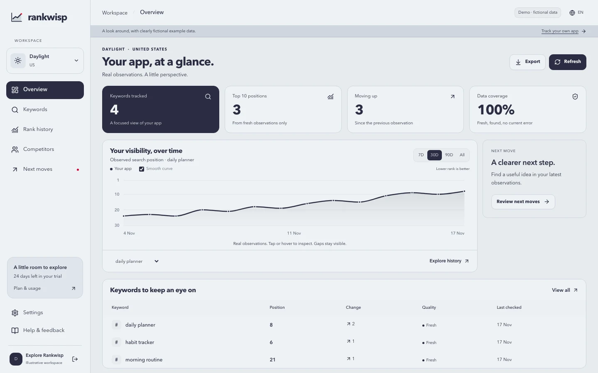
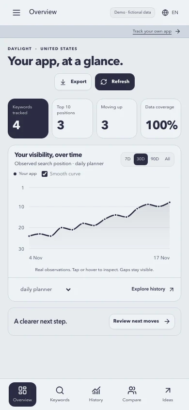
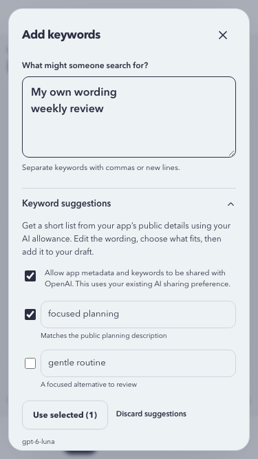

<p align="center">
  
</p>

<h1 align="center">Rankwisp</h1>
<p align="center"><strong>Open-source App Store keyword research.</strong><br>Track search positions. Compare apps. Find your next useful keyword.</p>

<p align="center">
  <a href="https://github.com/Yann1s2/Rankwisp/actions/workflows/ci.yml"></a>
  <a href="LICENSE"></a>
  <a href="https://github.com/Yann1s2/Rankwisp/releases/tag/v0.2.2-preview.1"></a>
</p>

<p align="center">
  <a href="https://rank.zhstudio.ch/app/?demo=1"></a>
  <a href="https://github.com/Yann1s2/Rankwisp/releases/tag/v0.2.2-preview.1"></a>
</p>
<p align="center"><a href="#quick-start">Run locally</a> · <a href="docs/GETTING-STARTED.md">Documentation</a> · <a href="CONTRIBUTING.md">Contribute</a> · <a href="README.de.md">Deutsch</a></p>

Rankwisp helps indie iOS developers explore **App Store optimization (ASO)** with inspectable data. Follow keyword positions across 20 storefronts, compare selected competitors and keep a history you can export. The web app, desktop clients and backend are all MIT-licensed.

> **Public preview:** the interactive demo uses fictional data and needs no account. Hosted Google sign-in is enabled. Apple sign-in, AI generation and purchases still need activation. The hosted Apple Search API currently returns rate-limit errors; no observations are invented. For real research today, [run the local app](#quick-start); Apple search does not require an API key.

[](https://rank.zhstudio.ch/app/?demo=1)
<p align="center"><sub>Actual application screenshot · illustrative demo data · <a href="https://rank.zhstudio.ch/app/?demo=1">explore it yourself</a></sub></p>

## A small workspace for a clearer next move

- **Follow keywords over time.** See observed search positions, missing results and failed requests without filling gaps with invented data.
- **Compare apps with context.** Choose your own competitors, review suggestions and inspect the observations behind each comparison.
- **Keep control of AI ideas.** Optional Luna keyword proposals can be edited and selected before saving. Generation requires your own configured provider key and explicit consent.
- **Keep your history.** Import and export JSON, archive keywords without deleting observations, and recover from an import.
- **Use a focused interface.** English and German UI, keyboard navigation, compact mobile layouts and reduced-motion support.
- **Inspect or self-host the whole stack.** React, Electron and Capacitor clients; Cloudflare Workers/D1/Durable Objects backend; local Node/SQLite alternative.

<table>
  <tr>
    <td align="center"><strong>A workspace that fits your phone</strong></td>
    <td align="center"><strong>Keyword ideas you can change</strong></td>
  </tr>
  <tr>
    <td align="center"></td>
    <td align="center"></td>
  </tr>
  <tr>
    <td align="center"><sub>Live demo · fictional observations</sub></td>
    <td align="center"><sub>UI test fixture · not a live AI result</sub></td>
  </tr>
</table>

## Try it or download a preview

**The fastest start is the [browser demo](https://rank.zhstudio.ch/app/?demo=1).** No installation, account or card required.

| Platform | Download | What to expect |
| --- | --- | --- |
| macOS · Apple Silicon | [Download ZIP](https://github.com/Yann1s2/Rankwisp/releases/download/v0.2.2-preview.1/Rankwisp-0.2.2-mac-arm64.zip) | Packaged app tested on macOS; not Developer-ID signed or notarized |
| Windows · x64 | [Download ZIP](https://github.com/Yann1s2/Rankwisp/releases/download/v0.2.2-preview.1/Rankwisp-0.2.2-win.zip) | Portable preview; unsigned and not yet runtime-tested on Windows |
| iOS Simulator · previous 0.2.0 | [Download ZIP](https://github.com/Yann1s2/Rankwisp/releases/download/v0.2.0-preview.1/Rankwisp-0.2.0-ios-simulator.zip) | Ad-hoc signed simulator app, verified on iOS 18.6; not an iPhone installer |
| Source code | [Download ZIP](https://github.com/Yann1s2/Rankwisp/archive/refs/tags/v0.2.2-preview.1.zip) | Build, inspect or modify under MIT |

Native previews connect to the hosted backend. Google sign-in was verified in the browser and packaged macOS app, including session restoration and logout. Apple sign-in is implemented but awaits provider credentials. The local web setup remains available while hosted Apple Search API requests are rate-limited. See [release notes and SHA-256 checksums](https://github.com/Yann1s2/Rankwisp/releases/tag/v0.2.2-preview.1) before installing. No Linux desktop binary or App Store release is offered yet.

## Quick start

Requires **Node.js 22.20+**, npm and Git. Run from a terminal:

```sh
git clone https://github.com/Yann1s2/Rankwisp.git
cd Rankwisp/app
npm ci
npm run build
npm run server
```

Open **[http://127.0.0.1:4318/app/](http://127.0.0.1:4318/app/)**. Choose **Continue with email**, then **New here? Start your free trial**. This creates a local account, not a hosted Google account. Find an app, choose a storefront, add keywords and press **Refresh** for the first observation. Nothing is backfilled.

Local data lives in `app/.data/`, which is excluded from Git. Optional AI, Google OAuth and payments need separate server-side credentials. The default usage limits are described in the app; MIT licensing does not include free hosted services or provider credits.

[First-run guide and troubleshooting →](docs/GETTING-STARTED.md)

## What a “position” means

Rankwisp records an app’s **one-based position in Apple’s public Search API response**. That order may differ from the App Store search shown on an iPhone. A missing result stays missing; a failed request stays an error. Search volume, downloads, revenue, difficulty and market share are not measured or fabricated. AI keyword ideas are hypotheses to review, not ranking guarantees.

## Built in the open

| Area | Current evidence |
| --- | --- |
| Automated checks | Node, workerd, browser, website and native-bridge suites are included; [current CI](https://github.com/Yann1s2/Rankwisp/actions/workflows/ci.yml) is the source of truth |
| Live deployment | GitHub → Cloudflare Pages, separate production/preview Workers and data stores |
| Native verification | Packaged macOS runtime and iOS 18.6 simulator launch checked; Windows runtime remains open |
| Provider integrations | Google web/macOS login tested live; Apple OIDC tested with signed fixtures, activation pending; AI credentials still required |
| Security | Public source/history scanned for secrets; [private vulnerability reporting](https://github.com/Yann1s2/Rankwisp/security/advisories/new) enabled |

[Detailed QA and remaining release requirements](docs/QA.md) · [Security policy](SECURITY.md) · [Roadmap](ROADMAP.md)

<details>
<summary><strong>Architecture and development</strong></summary>

```text
React UI ── Web / Electron / Capacitor
    │
    ├── Cloudflare Pages → Workers → D1 + per-account Durable Objects
    └── Local Node server → SQLite
```

| Path | Purpose |
| --- | --- |
| `app/src` | Shared application and English/German website |
| `app/worker`, `app/functions` | Cloudflare API, Google auth, storage and Pages integration |
| `app/server`, `app/shared` | Shared domain logic and local server |
| `app/desktop`, `app/ios` | Native wrappers and secure storage bridges |
| `legacy` | Preserved Swift client with an empty seed dataset |

```sh
cd app
npm test
npm run test:worker
npm run build:pages
npx playwright install chromium
npm run test:browser
```

Deployment needs your own Cloudflare resources and provider configuration. Never deploy the example production identifiers as if they belonged to your account. See [Cloudflare operations](docs/OPERATIONS.md), [backend/OAuth setup](docs/CLOUDFLARE-BACKEND.md) and [native build instructions](docs/GETTING-STARTED.md#native-builds).

</details>

## Help shape Rankwisp

Try a real storefront, report a reproducible bug, improve a translation or help test accessibility. [Contributing](CONTRIBUTING.md) explains how to start; the [roadmap](ROADMAP.md) lists useful next steps. No provider credentials are needed to run the automated tests.

If this is useful to you, **star the repository** to keep it on your radar. Feedback about your first run is just as welcome.

Maintained by [Yannis Ress Lasser / ZhStudio](https://zhstudio.ch) · [info@zhstudio.ch](mailto:info@zhstudio.ch)

**[MIT license](LICENSE)** · Dependencies retain their [upstream licenses](THIRD_PARTY_NOTICES.md). Source availability does not include access to the hosted service’s accounts, credentials or infrastructure.
